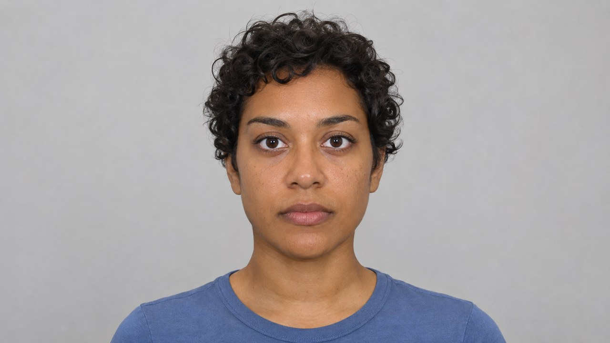

# Avatar

Локальный аватар для Zoom и набор компонентов для русскоязычного голосового агента. Для своего аватара подготовьте портрет или модель персонажа, запись своего голоса и, если нужны самостоятельные ответы, короткий бриф. Демо-портрет изображает вымышленного человека.

| Режим | Компоненты | Статус |
| --- | --- | --- |
| Говорю сам, аватар повторяет речь | LivePortrait, DH_live Mini, DINet, Silero, OBS Virtual Camera, VB-CABLE | Локальный портрет и анимация. Для Zoom есть инструкция по выводу и проверке синхронизации |
| Аватар отвечает сам | Whisper.cpp, Qwen3.5 через llama.cpp, Qwen3-TTS 12Hz 1.7B Base | Локальный пример принимает запись вопроса и выдаёт озвученный ответ. Соединение с живым видео и Zoom описано в проекте интеграции |
| Новый 3D-персонаж | VRM 1.0, Three.js, Audio2Face-3D | Предлагаемая архитектура. Нужны лицевой риг, настройка соответствия форм и сквозной тест |

## Быстрый запуск портрета

Понадобятся Windows x64, NVIDIA GPU с CUDA, Python 3.13 x64, Git, Chrome или Edge. Для Zoom установите OBS Studio, а для передачи звука с тем же буфером установите VB-CABLE. Зависимости ставятся в локальное окружение. Модели скачиваются из upstream по манифесту с версиями и контрольными суммами.

~~~powershell
py -3.13 -m venv .venv
.venv\Scripts\python.exe -m pip install torch --index-url https://download.pytorch.org/whl/cu130
.venv\Scripts\python.exe -m pip install -r requirements-portrait.txt
.venv\Scripts\python.exe scripts/setup_models.py portrait
.venv\Scripts\python.exe scripts/prepare_portrait.py examples/demo/portrait.jpg profiles/demo
.venv\Scripts\python.exe avatar_identity_live.py --profile profiles/demo
~~~

Откройте <http://127.0.0.1:8776/>. После прогрева должна появиться картинка. Микрофон включается кнопкой. Для тестовой записи без микрофона можно воспроизвести любой синтетический WAV через тестовое устройство браузера. Текст на русские согласные и генератор WAV входят в [демо](examples/demo/).

Чтобы поставить своё лицо, передайте в `prepare_portrait.py` свой нейтральный снимок или начальные 2 секунды видео. Выберите кадр прямо перед камерой, с открытыми глазами, расслабленным ртом, видимыми шеей и плечами. Для другой одежды можно записать портрет в нужном костюме, для другого фона положите `background.png` в папку профиля. [Подготовка профиля и настройки Zoom](docs/setup.md).

## Голос и ответы

Для клонирования подготовьте 8–10 секунд чистой речи одного человека. Опциональная точная расшифровка помогает перенести произношение. Команда синтеза пишет WAV, который можно прослушать до подключения к видео.

~~~powershell
.venv\Scripts\python.exe -m pip install -r requirements-voice.txt
.venv\Scripts\python.exe scripts/setup_models.py voice
.venv\Scripts\python.exe avatar_voice.py --reference input/voice.wav --text "Добрый день! Я могу объяснить, как устроен аватар." --output output/answer.wav
~~~

В [инструкции для разговорного режима](docs/setup.md#голос-и-ответы) показано, как подключить Whisper.cpp и локальный llama.cpp. В [описании архитектуры](docs/architecture.md) — как устроены веки, губы, очередь кадров и будущий 3D-персонаж. В [статусе и замерах](docs/status.md) — что проверили и где пока остаются дефекты. [Источники моделей и условия использования](docs/models.md).
